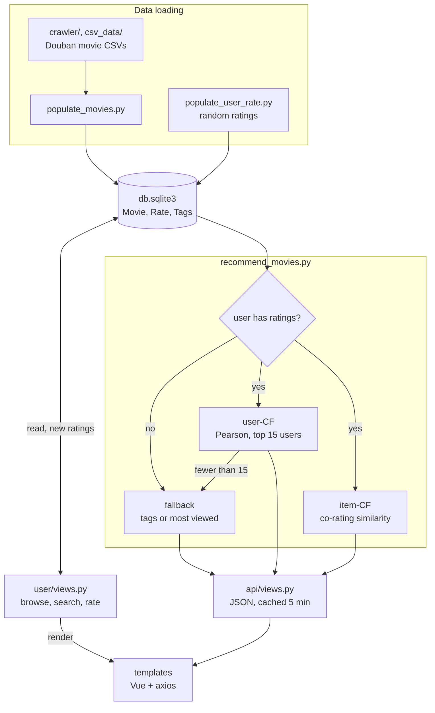
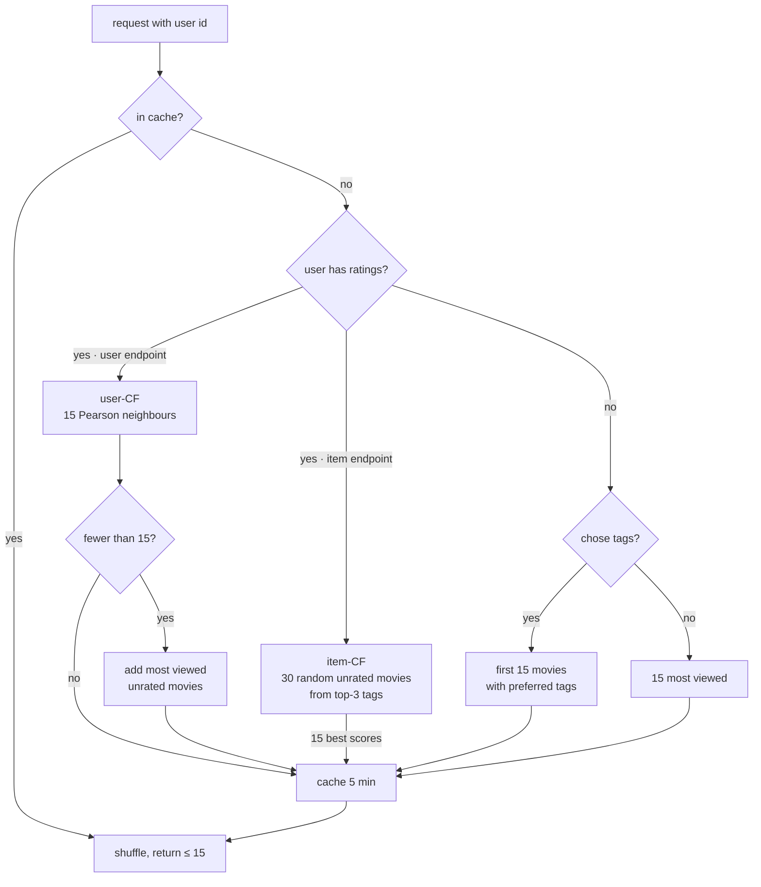
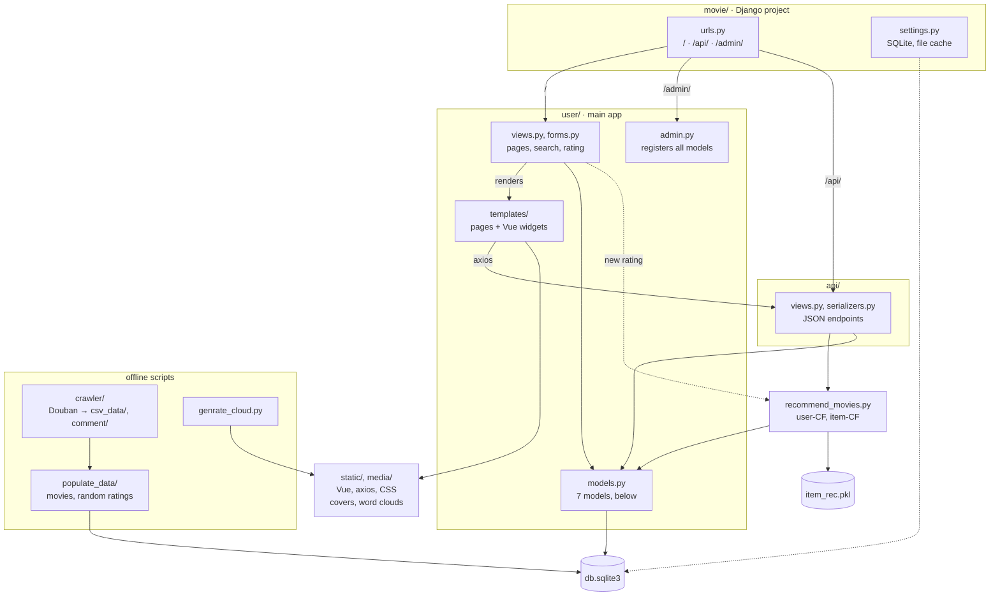
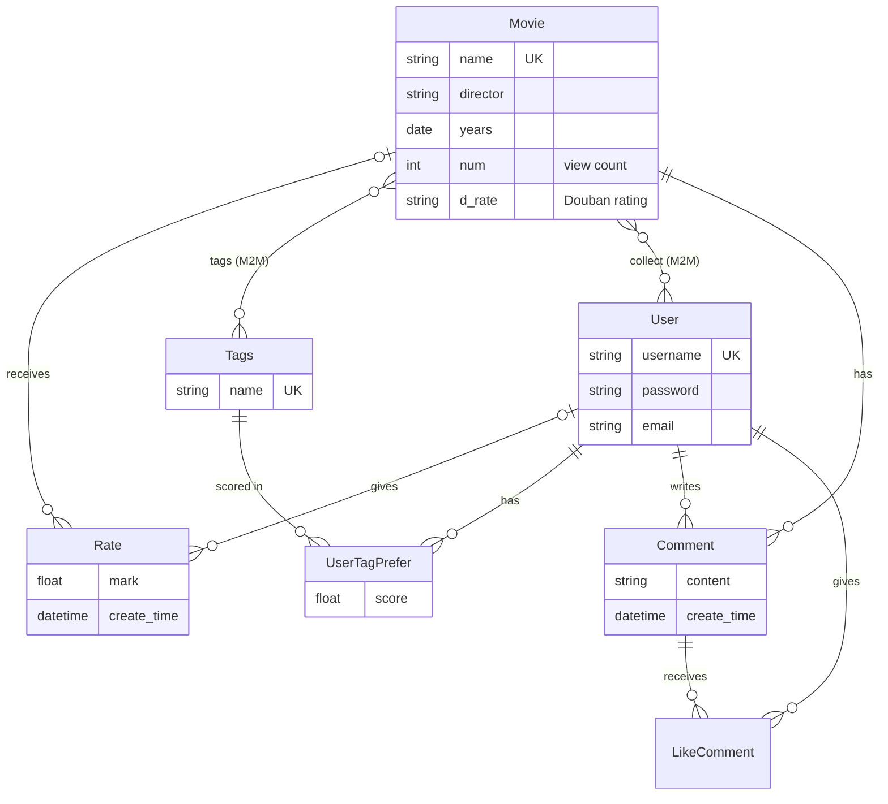

<div align="center">

# Movie Recommendation System

**English** · [简体中文](README.zh-CN.md)

**A Django movie site with user- and item-based collaborative filtering · 基于 Django 和协同过滤的电影推荐系统**


[](https://www.ccao2679.com/projects/#movie-recommendation-system)


</div>

<!-- problem-framing:start -->

## Problem and evidence

> **With sparse ratings, can collaborative filtering recommend movies a user has not yet rated better than a popularity ranking, while keeping usable coverage for new users?**

**Why it matters:** A recommendation page is not the same as useful recommendations. The system has to show that the personalised signal improves the ranking, and that it falls back explicitly when there are too few ratings.

**Central tension:** Stricter filtering of similar users may raise relevance but shrinks the candidate set; the popularity fallback raises coverage but can also hide that the personalised part contributes nothing.

[Full problem and verification plan](PROBLEM.md) · [中文](PROBLEM.zh.md)

<!-- problem-framing:end -->

## Highlights

- **Recommendations:** user-based CF (Pearson correlation, 15 nearest users; when it finds fewer than 15 movies it tops up with the most-viewed unrated ones) and item-based CF (co-rating similarity computed per request for 30 random unrated movies from the user's three top tags). Users with no ratings get movies from their chosen tags or the most-viewed list.
- **Site:** sign-up and login, search by title, director or description, browse by tag, rate, comment and save favourites; Django admin for management; word clouds from reviews.
- **Data:** movie details, tags and reviews crawled from Douban into CSV and loaded into SQLite. The ratings in the bundled `db.sqlite3` are synthetic: `populate_user_rate.py` created 400 random accounts with 2,200 random 1–5 ratings (2,201 ratings from 401 users in total).

## Architecture



Arrows follow the data: ratings in `db.sqlite3` feed the recommenders, whose lists reach the page through the JSON endpoints in `api/views.py`. How each list is computed is in [Recommendation algorithm](#recommendation-algorithm); how the code is split into packages and models is in [Project structure](#project-structure).

## Recommendation algorithm

Both recommenders are in `recommend_movies.py` and reach the page through two endpoints in `api/views.py`: `/api/user_recommend/<user_id>` (user-CF, right-hand sidebar, 5 shown) and `/api/item_recommend/<user_id>` (item-CF, carousel on movie pages, 10 shown). Each returns up to 15 movies in random order; without a user id (logged out), both return every movie in random order.



### User-based CF

`recommend_by_user_id(user_id)`

**Rating table.** At start-up, `get_all_user()` loads every rating into memory as `{username: {movie_id: mark}}`. After a new rating, `update_all_user` adds the user if they are not in it yet; existing entries are not refreshed (`setdefault`).

**Similarity.** `UserCf.pearson` compares the target user $`u`$ with every other user $`v`$ over $`I_{uv}`$, the movies both have rated, with $`n = \lvert I_{uv} \rvert`$ and marks $`x_i`$ (from $`u`$) and $`y_i`$ (from $`v`$). All sums run over $`I_{uv}`$:

$$
r_{uv}=\frac{\sum x_i y_i-\frac{1}{n}\sum x_i\sum y_i}{\sqrt{\left(\sum x_i^2-\frac{1}{n}\left(\sum x_i\right)^2\right)\left(\sum y_i^2-\frac{1}{n}\left(\sum y_i\right)^2\right)}}
$$

This is Pearson's correlation with the means taken over the shared movies only. It is 0 when the two users share no movie or the denominator is 0 (a single shared movie, or one side gave every shared movie the same mark).

**Neighbours.** All other users are sorted by $`r_{uv}`$ and the top 15 are kept. There is no threshold: users with zero or negative correlation become neighbours when there are not enough positive ones, and ties keep database order.

**Scoring.** The neighbours are read from most to least similar. Each movie a neighbour rated and $`u`$ has not becomes a candidate, scored with that neighbour's mark; later neighbours do not change the score. The similarity therefore decides the order in which neighbours are read but is not a weight: the similarity-weighted prediction in the original notes is not implemented. `UserCf.recommend` returns all candidates sorted by score.

**Top 15.** `recommend_by_user_id` then loads the candidate ids with `Movie.objects.filter(id__in=…)`, which returns rows in database order, not score order, keeps the first 15 and shuffles them. If there are fewer than 15, it appends the user's unrated movies with the most views (`Movie.num`) until there are 15.

### Item-based CF

`recommend_by_item_id(user_id)` computes similarities on every request instead of reading a stored matrix.

**Candidates.** The user's top 3 tags by `UserTagPrefer.score`: choosing a tag after sign-up gives it 5, and a new rating gives each of the movie's tags the mark if the user has no score for that tag yet, and otherwise adds mark − 3. Up to 30 movies carrying any of these tags that the user has not rated are drawn at random (`order_by('?')`). A user with no tag preferences gets no candidates and an empty list.

**Similarity.** With $`N(i)`$ the set of users who rated movie $`i`$, `similarity()` counts raters with three queries per pair:

$$
w_{ij}=\frac{\lvert N(i)\cap N(j)\rvert}{\sqrt{\lvert N(i)\rvert\cdot\lvert N(j)\rvert}}
$$

**Scoring.** The loop runs over candidates × rated movies, but the `names` check records each candidate only once, so every candidate $`j`$ is scored against the first rated movie $`m`$ the query returns: $`s_j = w_{jm}\, r_{um}`$. Because $`r_{um}`$ is the same for every candidate, the order is the similarity to that one movie. The 15 highest scores are kept, with no top-up.

**Precomputed matrix, unused.** `ItemBasedCF` computes the same $`w_{ij}`$ over the whole rating table when `runserver` starts, saves it to `item_rec.pkl` and updates it after every new rating (`update_item_movie_sim_matrix`). Its `recommend()` method, which sums $`w_{ij}\, r_{ui}`$ over the 100 most similar movies of each rated one, is never called, so the matrix does not affect what is served.

### Cold start and caching

**Fallback.** Both endpoints fall back only when the user has no ratings at all. They return the first 15 movies (database order) carrying any of the user's preferred tags (all of them for user-CF, the top 3 for item-CF) or, if the user never chose tags, the 15 most-viewed movies. Apart from this, popularity is used only by the user-CF top-up.

**Cache.** Each list is cached for 5 minutes in Django's file-based cache (`/var/tmp/django_cache`) under the key `{user_id}_user_cached`. Both endpoints read and write this same key (`USER_CACHE`), so for 5 minutes either can return the list the other computed, and a movie page requests both at once. A new rating deletes the user's cache keys; `/clear_cache/` empties the whole cache.

### Worked example

Made-up ratings for three users and four movies; Alice is the target user and – means not rated.

| | M1 | M2 | M3 | M4 |
|---|:-:|:-:|:-:|:-:|
| Alice | 5 | 2 | – | – |
| Bob | 4 | 1 | 2 | – |
| Carol | 1 | 4 | 5 | 4 |

Alice shares M1 and M2 with both others, so $`n = 2`$ and $`x = (5, 2)`$, with $`\sum x_i = 7`$ and $`\sum x_i^2 = 29`$. Bob's marks are $`y = (4, 1)`$: $`\sum y_i = 5`$, $`\sum y_i^2 = 17`$ and $`\sum x_i y_i = 22`$.

$$
r_{AB}=\frac{22-\frac{7\cdot 5}{2}}{\sqrt{\left(29-\frac{7^2}{2}\right)\left(17-\frac{5^2}{2}\right)}}=\frac{4.5}{\sqrt{4.5\cdot 4.5}}=1
$$

Carol's marks are $`y = (1, 4)`$: the same $`\sum y_i = 5`$ and $`\sum y_i^2 = 17`$, but $`\sum x_i y_i = 13`$, so the numerator is $`13 - 17.5 = -4.5`$ and $`r_{AC} = -1`$. With only two shared movies, the correlation can only be 1, −1 or 0.

| Step | Result |
|---|---|
| Neighbours by $`r`$ | Bob (1), then Carol (−1); both kept |
| Read Bob | M3 scores 2 |
| Read Carol | M3 is already scored, so her 5 is ignored; M4 scores 4 |
| Ranking | M4 (4), then M3 (2) |

M4 comes first only because Carol, whose taste is opposite to Alice's, liked it, while M3 keeps the low mark of Bob, whose taste matches hers. Both movies are within the 15-movie cut and no other unrated movie is left to top up with, so Alice gets M3 and M4 in random order.

### On the bundled data

Running both functions for the 401 users with ratings in the bundled `db.sqlite3` (most have 5 random ratings among 2,181 movies): 389 users have no neighbour with positive similarity, so their 15 neighbours are just the first users in database order with similarity 0; 358 users get the same 15 user-CF movies; and item-CF returns an empty list for 400 users, because the seeded accounts have no tag preferences.

## Project structure



`movie/urls.py` routes `/` to the page views in `user/views.py`, `/api/` to `api/views.py` and `/admin/` to the Django admin, where `user/admin.py` registers every model. Pages extend `user/templates/base.html`, whose Vue widgets (Vue and axios are served from `static/js/`) fetch recommendations from `/api/`. After a new rating, `user/views.py` deletes the user's cache keys and calls into `recommend_movies.py` to update the item matrix and the in-memory ratings. `populate_data/` loads the crawled CSVs into `db.sqlite3` and seeds the random ratings; `genrate_cloud.py` turns the reviews in `comment/` into word clouds in `media/comment/`. `docs/` holds the senior-project slides and recorded walkthroughs.



`User` is the app's own model, not `django.contrib.auth`. Both recommenders read `Rate`; `UserTagPrefer` holds the tag scores behind the cold-start fallback and item-CF's candidate tags; `Movie.num` (views) drives the most-viewed fallback and top-up; `Movie.collect` stores favourites.

## Quick start

```bash
pip install -r requirements.txt
python manage.py runserver        # http://127.0.0.1:8000/  ·  admin at /admin
python manage.py createsuperuser  # optional, for the admin back end
```

## Known limitations

- User-CF ignores its own ranking: the candidates are reloaded with `filter(id__in=…)` and cut to the first 15 in database order, so the score has no effect whenever there are more than 15 candidates, which is the case for every user in the bundled data.
- User-CF scores a candidate with one neighbour's raw mark rather than a similarity-weighted average, and keeps neighbours with zero or negative similarity.
- The in-memory rating table only gains users that are missing from it (`update_all_user` uses `setdefault`), so user-CF ignores later ratings until a restart and can recommend a movie the user rated after start-up.
- Item-CF does not top up to 15 picks, so it returns fewer when the user's top tags have few unrated movies.
- Item-CF does not fall back once a user has ratings: without tag preferences (true of every seeded account) it returns an empty list.
- Item-CF scores each candidate against a single rated movie (the first one returned): the `names` check in `recommend_by_item_id` skips the others.
- `api/views.py` caches the user-CF and item-CF lists under the same key (`USER_CACHE`), so for 5 minutes one list can be served in place of the other.
- The `ItemBasedCF` similarity matrix (`item_rec.pkl`) is rebuilt when `runserver` starts and updated after each rating, but no endpoint uses it to serve recommendations.

<details>
<summary>原始文档（中文）</summary>

基于django和协同过滤的电影推荐系统

## Windows版本问题：

- 可能需要手动安装restframework这个django package
- 报C++14依赖错误

https://stackoverflow.com/questions/64261546/python-cant-install-packages

安装或modify VS Studio里面的C++ build tool然后再重新安装包

---

Mac一步到位，暂没啥问题

## 运行

包在requirements.txt里面，venv或者conda都可以

```python
#安装包
pip install -r requirenments.txt
```


```python
#运行服务器
python manage.py runserver
```

本地地址：

 http://127.0.0.1:8000/

后台地址：

http://127.0.0.1:8000/admin

## 技术

### 后端

django + sqlite3

#### django的优势

https://www.runoob.com/django/django-intro.html

Django 是一个由 Python 编写的一个开放源代码的 Web 应用框架。

<u>Python 加 Django 是快速开发、设计、部署网站的最佳组合</u>

使用 Django，只要很少的代码，Python 的程序开发人员就可以轻松地完成一个正式网站所需要的大部分内容，并进一步开发出全功能的 Web 服务 Django 本身基于 MVC 模型，即 Model（模型）+ View（视图）+ Controller（控制器）设计模式，MVC 模式使后续对程序的修改和扩展简化，并且使程序某一部分的重复利用成为可能。

- 强大的数据库功能
- 自带强大的后台功能

#### Sqlite3的优势

https://www.runoob.com/sqlite/sqlite-intro.html

- 不需要一个单独的服务器进程或操作的系统（无服务器的）。
- SQLite 不需要配置，这意味着不需要安装或管理。
- 一个完整的 SQLite 数据库是存储在一个单一的跨平台的磁盘文件。
- SQLite 是非常小的，是轻量级的，完全配置时小于 400KiB，省略可选功能配置时小于250KiB。
- SQLite 是自给自足的，这意味着不需要任何外部的依赖。

### 数据

python爬虫爬豆瓣信息存储到本地csv文件

正则表达 + 八爪鱼。自己爬的话注意时间间隔，豆瓣有反爬机制容易ban ip。IP池没搞

### 架构

MVC（model-view-controller）架构

https://www.runoob.com/design-pattern/mvc-pattern.html

MVC 模式使后续对程序的修改和扩展简化，并且使程序某一部分的重复利用成为可能


### 前端

bootstrap3 css 框架 （真不熟）


## 基本功能

1. 登陆注册

2. 基于协同过滤的电影的分类，排序，搜索，排序功能。

3. 对电影进行打分，评论

4. 收藏喜爱的电影

5. 管理员后台进行管理

   ```python
   # 创建超级管理员
   python manage.py createsuperuser
   ```

6. 根据豆瓣评论生成词云

## 各个功能的实现

标签分类: 

​	数据库设计Movie通过外键关联Tags表，
电影搜索: 

​	在views.py search方法中。通过电影名，导演名，介绍去进行关键字搜索。
后台管理: 

​	通过django自带的admin后台加插件 在admins.py中注册数据库模型
推荐算法: 

​	在recommend_movies.py

- recommend_by_user_id为user-CF的入口函数
- recommend_by_item_id为item-CF的入口函数

网页显示：
前端: 

​	items.html
后端: 

​	views.py中 388行 user_recommend 传递数据到前端template
算法：

​	recommend_movies.py

## 基于启发式的协同过滤算法

recommend_movies.py

### 三个步骤：

1）收集用户偏好信息；
2）寻找相似的商品或者用户；
3）产生推荐

通过协调过滤计算和其他用户的距离，然后进行筛选。如果用户数量不足，推荐数目不够15条，就会自动从
所有未打分的电影中按照浏览数降序选一部分填充进去。

### 计算用户对未评分商品的预测分值

根据相似度计算，寻找用户u的邻居集N∈U，其中N表示邻居集，U表示用户集。然后，结合用户评分数据集，预测用户u对项i的评分


​	s（u，u'）表示用户u和用户u'的相似度

### 基本点

1. 兴趣相近的用户可能会对同样的东西感兴趣
2. 用户可能较偏爱与其已购买的东西相类似的商品

### 基于用户的推荐

定义：用相似统计的方法得到具有相似爱好或者兴趣的相邻用户，所以称之为以用户为基础（User-based）的协同过滤或基于邻居的协同过滤(Neighbor-based Collaborative Filtering)。


1. 用户需要给电影打分。通过用户已打分的部分来计算相似度(采用<u>皮尔逊关系系数</u>或者<u>余弦相似度</u>),如果用户未打分，或者没有其他用户，则按照浏览数降序返回。

2. 通过pearson算法来计算用户之间的距离，找到距离最近的N个用户。将这些用户中已打分的电影(且要推荐的用户未看过的部分)返回。

   #### **皮尔逊相关系数**Correlation Coefficient的计算公式

   

   #### **余弦相似度**Cosine-based Similarity的计算公式

   

### 基于项目的推荐

1. 计算物品相似度矩阵
2. 遍历当前用户已打分的item，计算和未打分的item的相似距离。
3. 对相似距离进行排序返回

​	[推荐算法—协同过滤 - 简书](https://www.jianshu.com/p/5463ab162a58)

### 文章参考

[推荐算法—协同过滤 - 简书](https://www.jianshu.com/p/5463ab162a58)
[协同过滤和基于内容推荐有什么区别？ - 知乎](https://www.zhihu.com/question/19971859)

## 文件功能

1. api

   调用的端口

2. comment

   爬取的评论

3. crawler/ 

   爬虫文件

4. csv_data/ 

   需要爬取的数据

5. log/ 

   日志

6. media/ 

   静态文件（评论 和 电影封面）

7. movie/

   django的默认文件，负责设置的配置、url路由和部署

8. populate_data/

   1. 填充数据

      populate_movies.pypopulate_movies.py

   2. 清除数据

      clear_movies.py

   3. 更新图片

      update_pic.py

   4. 随机生成数据

      populate_user_rate.py


9. static/

   css文件和js文件保存处

10. user/

    主要文件夹，基本所有代码都在这里

    1. user/migrations/ 为自动生成的数据库迁移文件夹
    2. user/templates/ 为前端页面模板文件夹
    3. user/admins.py 为管理员后台代码 
    4. user/forms.py为前端表单代码 
    5. user/models.py为数据库orm模型 
    6. user/serializers.py为restful文件（不用管）
    7.  user/urls为路由注册文件 
    8. user/views为负责处理前端请求和与后端数据库交互的模块，也就是controller模块。

11. venv/

    虚拟环境以及包

12. cache.py 

    存放缓存的key值名称的文件（不用动）

13. db.sqlite3

    数据库文件

14. genrate_cloud.py

    生成词云的代码

15. manage.py

    运行主程序，从这里启动

16. recommend_movies.py

    推荐算法的代码

17. requirements.txt

    所需要的依赖包

18. *.mp4

    操作录屏

# 参考代码

https://github.com/Colaplusice/movie1_recommend

https://github.com/Colaplusice/movie_recommend

</details>
