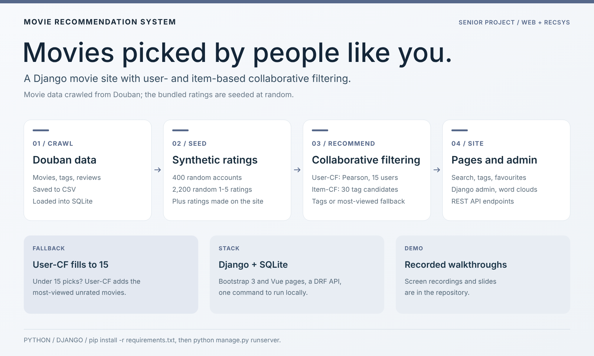
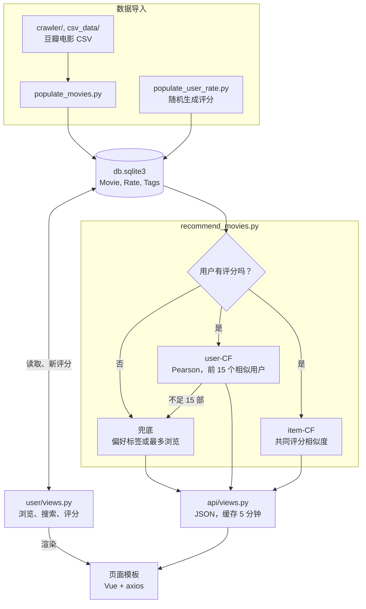
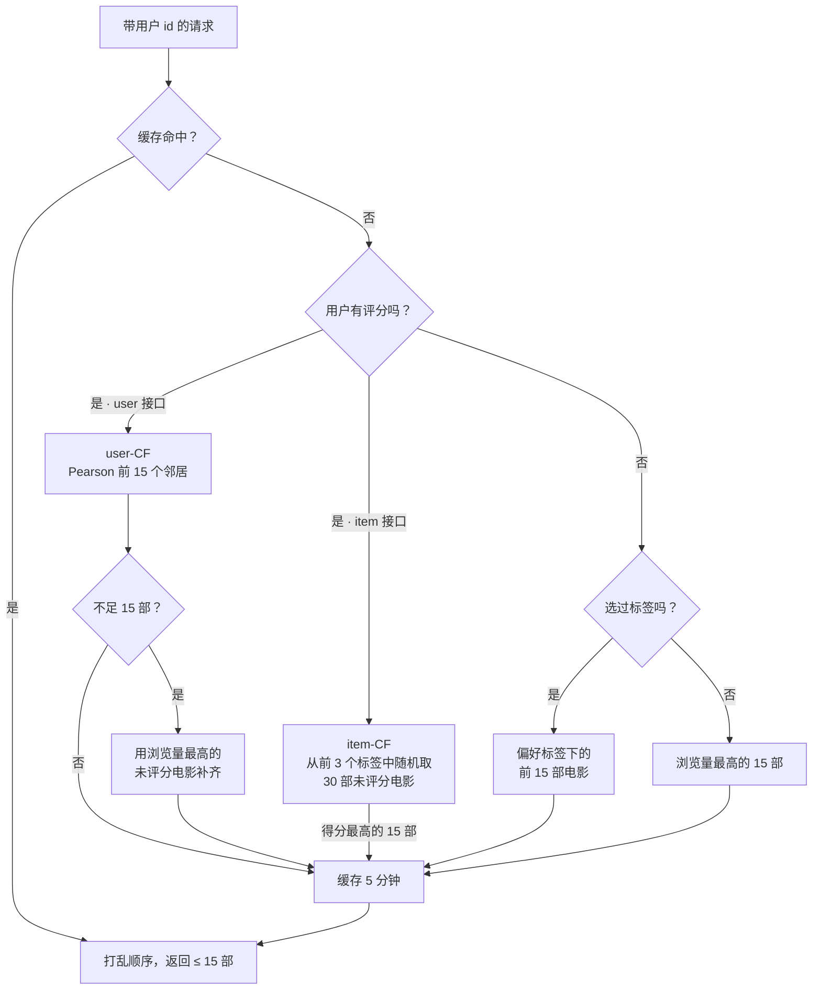
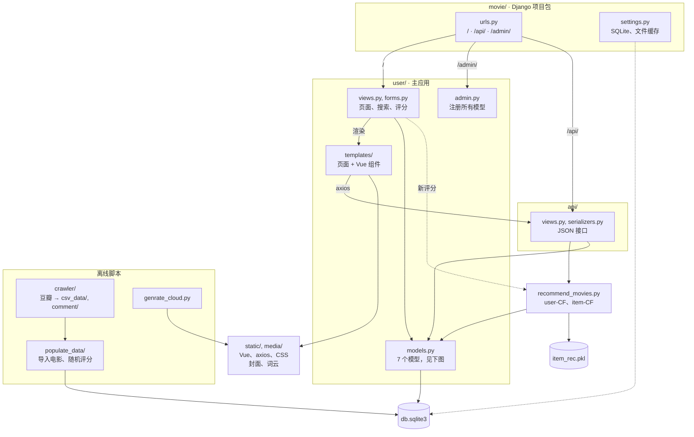
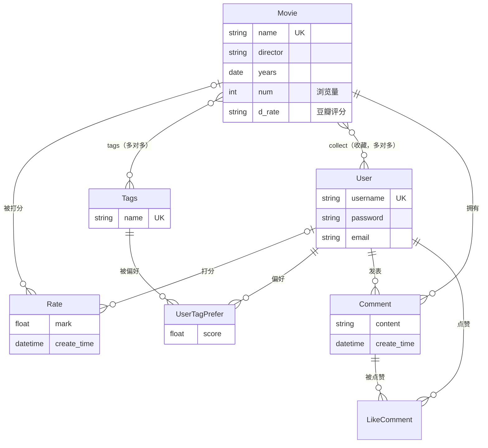

<div align="center">

# Movie Recommendation System

[English](README.md) · **简体中文**

**基于 Django 的电影推荐网站，同时实现基于用户和基于物品的协同过滤**


[](https://www.ccao2679.com/projects/#movie-recommendation-system)



</div>

<!-- problem-framing:start -->

## 问题与依据

> **在稀疏评分下，协同过滤能否比热门电影排序更好地推荐用户尚未评分的电影，同时保持新用户的可用覆盖？**

**为什么值得解决：** 有推荐页面不等于推荐有用。系统需要证明个性化信号能改善排序，并在评分不足时提供明确的回退行为。

**核心矛盾：** 更严格的相似用户筛选可能提高相关性，却缩小候选集合；热门回退提高覆盖，也可能掩盖个性化模块没有贡献。

[完整问题与验证方案](PROBLEM.zh.md) · [English](PROBLEM.md)

<!-- problem-framing:end -->

## 亮点

- **推荐：** 基于用户的协同过滤（Pearson 相关系数，取最相似的 15 个用户；找到的电影不足 15 部时，用该用户未评分、浏览量最高的电影补齐）与基于物品的协同过滤（每次请求时从用户最偏好的 3 个标签中随机抽取 30 部未评分电影，现场计算共同评分相似度）。没有评分的用户会拿到所选标签下的电影或浏览量最高的电影。
- **网站：** 注册与登录，按片名、导演或简介搜索，按标签浏览，评分、评论和收藏；用 Django admin 做后台管理；根据影评生成词云。
- **数据：** 电影信息、标签和影评从豆瓣爬取，存成 CSV 后导入 SQLite。仓库自带的 `db.sqlite3` 中的评分是随机生成的：`populate_user_rate.py` 创建了 400 个随机账户，共 2,200 条 1–5 分的随机评分（合计 401 个用户、2,201 条评分）。

## 架构



箭头表示数据流向：`db.sqlite3` 中的评分输入推荐模块，推荐列表经 `api/views.py` 的 JSON 接口送到页面。每个列表如何计算见[推荐算法](#推荐算法)，代码如何按包和数据模型组织见[项目结构](#项目结构)。

## 推荐算法

两个推荐器都在 `recommend_movies.py` 中，通过 `api/views.py` 的两个接口送到页面：`/api/user_recommend/<user_id>`（user-CF，页面右侧边栏，展示 5 部）和 `/api/item_recommend/<user_id>`（item-CF，电影详情页的轮播，展示 10 部）。每个接口最多返回 15 部电影，顺序随机；没有用户 id（未登录）时，两个接口都返回全部电影的随机排列。



### 基于用户的协同过滤

`recommend_by_user_id(user_id)`

**评分表。** 启动时，`get_all_user()` 把所有评分以 `{username: {movie_id: mark}}` 的形式载入内存。用户新增评分后，如果该用户还不在表中，`update_all_user` 会把他加进去；已有的条目不会刷新（用的是 `setdefault`）。

**相似度。** `UserCf.pearson` 在 $`I_{uv}`$ 上比较目标用户 $`u`$ 和其他每个用户 $`v`$：$`I_{uv}`$ 是两人都评过分的电影，$`n = \lvert I_{uv} \rvert`$，$`x_i`$、$`y_i`$ 分别是 $`u`$ 和 $`v`$ 的评分。下式的求和都在 $`I_{uv}`$ 上进行：

$$
r_{uv}=\frac{\sum x_i y_i-\frac{1}{n}\sum x_i\sum y_i}{\sqrt{\left(\sum x_i^2-\frac{1}{n}\left(\sum x_i\right)^2\right)\left(\sum y_i^2-\frac{1}{n}\left(\sum y_i\right)^2\right)}}
$$

这就是 Pearson 相关系数，只不过均值只在共同评分的电影上计算。两人没有共同评分的电影，或者分母为 0（只有一部共同电影，或某一方给所有共同电影打了相同的分）时，相似度取 0。

**邻居。** 所有其他用户按 $`r_{uv}`$ 从高到低排序，取前 15 个。没有阈值：正相关的用户不够时，相关系数为 0 甚至为负的用户也会成为邻居；相似度相同时保持数据库顺序。

**打分。** 按相似度从高到低依次读取邻居。邻居评过、而 $`u`$ 没评过的电影成为候选，得分就是这个邻居给的评分，后面的邻居不会再改动它。所以相似度只决定读取邻居的先后，并不作为权重：原始笔记中描述的相似度加权预测并没有实现。`UserCf.recommend` 返回按得分排序的全部候选。

**取前 15 部。** 随后 `recommend_by_user_id` 用 `Movie.objects.filter(id__in=…)` 取回候选电影，返回的是数据库顺序而不是得分顺序；它保留前 15 部并打乱顺序。不足 15 部时，按浏览量（`Movie.num`）从高到低追加该用户未评分的电影，直到凑满 15 部。

### 基于物品的协同过滤

`recommend_by_item_id(user_id)` 在每次请求时现场计算相似度，而不是读取预先存好的矩阵。

**候选。** 取用户 `UserTagPrefer.score` 最高的 3 个标签：注册后选择的标签记 5 分；用户新增评分时，该电影的每个标签如果还没有分数，就记为这次的评分，否则加上“评分 − 3”。然后从带有这些标签、且用户没评过分的电影中随机抽取最多 30 部（`order_by('?')`）。没有标签偏好的用户拿不到候选，结果是空列表。

**相似度。** 记 $`N(i)`$ 为给电影 $`i`$ 评过分的用户集合，`similarity()` 对每对电影用三次查询统计评分人数：

$$
w_{ij}=\frac{\lvert N(i)\cap N(j)\rvert}{\sqrt{\lvert N(i)\rvert\cdot\lvert N(j)\rvert}}
$$

**打分。** 循环遍历“候选 × 已评分电影”，但 `names` 判断使每个候选只记录一次，所以每个候选 $`j`$ 只和查询返回的第一部已评分电影 $`m`$ 比较：$`s_j = w_{jm}\, r_{um}`$。由于 $`r_{um}`$ 对所有候选都一样，排序实际上就是按与这一部电影的相似度排序。保留得分最高的 15 部，不做补齐。

**预计算矩阵（未使用）。** `ItemBasedCF` 在 `runserver` 启动时基于全部评分计算同样的 $`w_{ij}`$，保存到 `item_rec.pkl`，并在每条新评分后更新（`update_item_movie_sim_matrix`）。它的 `recommend()` 方法会对每部已评分电影最相似的 100 部电影累加 $`w_{ij}\, r_{ui}`$，但从未被调用，所以这个矩阵不影响实际返回的推荐。

### 冷启动与缓存

**兜底。** 只有当用户一条评分都没有时，两个接口才会兜底：返回带有用户偏好标签的前 15 部电影（数据库顺序，user-CF 用全部偏好标签，item-CF 只用前 3 个）；如果用户从未选过标签，则返回浏览量最高的 15 部。除此之外，只有 user-CF 的补齐步骤会用到热度。

**缓存。** 每个列表在 Django 的文件缓存（`/var/tmp/django_cache`）中以 `{user_id}_user_cached` 为键缓存 5 分钟。两个接口读写的是同一个键（`USER_CACHE`），因此 5 分钟内任一接口都可能返回另一个接口算出的列表，而电影详情页恰好会同时请求这两个接口。用户新增评分时会删除其缓存键；`/clear_cache/` 会清空整个缓存。

### 计算示例

虚构评分：三个用户、四部电影；Alice 是目标用户，“–”表示未评分。

| | M1 | M2 | M3 | M4 |
|---|:-:|:-:|:-:|:-:|
| Alice | 5 | 2 | – | – |
| Bob | 4 | 1 | 2 | – |
| Carol | 1 | 4 | 5 | 4 |

Alice 与 Bob、Carol 共同评过的都是 M1 和 M2，所以 $`n = 2`$，$`x = (5, 2)`$，$`\sum x_i = 7`$，$`\sum x_i^2 = 29`$。Bob 的评分为 $`y = (4, 1)`$：$`\sum y_i = 5`$，$`\sum y_i^2 = 17`$，$`\sum x_i y_i = 22`$。

$$
r_{AB}=\frac{22-\frac{7\cdot 5}{2}}{\sqrt{\left(29-\frac{7^2}{2}\right)\left(17-\frac{5^2}{2}\right)}}=\frac{4.5}{\sqrt{4.5\cdot 4.5}}=1
$$

Carol 的评分为 $`y = (1, 4)`$：$`\sum y_i = 5`$ 和 $`\sum y_i^2 = 17`$ 不变，但 $`\sum x_i y_i = 13`$，分子为 $`13 - 17.5 = -4.5`$，所以 $`r_{AC} = -1`$。只有两部共同电影时，相关系数只可能是 1、−1 或 0。

| 步骤 | 结果 |
|---|---|
| 按 $`r`$ 排序的邻居 | Bob（1），然后 Carol（−1），两人都保留 |
| 读取 Bob | M3 得 2 分 |
| 读取 Carol | M3 已有得分，她给的 5 分被忽略；M4 得 4 分 |
| 排序 | M4（4），然后 M3（2） |

M4 排在前面，只是因为与 Alice 口味相反的 Carol 喜欢它；而 M3 沿用的是与 Alice 口味一致的 Bob 给的低分。两部电影都在 15 部的截取范围内，也没有别的未评分电影可用来补齐，所以 Alice 最终拿到随机顺序的 M3 和 M4。

### 在自带数据上的表现

对自带 `db.sqlite3` 中 401 个有评分的用户（大多数人在 2,181 部电影中只有 5 条随机评分）运行这两个函数：389 个用户没有相似度为正的邻居，他们的 15 个邻居只是数据库顺序中相似度为 0 的前 15 个用户；358 个用户得到完全相同的 15 部 user-CF 推荐；item-CF 对 400 个用户返回空列表，因为随机生成的账户没有标签偏好。

## 项目结构



`movie/urls.py` 把 `/` 路由到 `user/views.py` 中的页面视图，把 `/api/` 路由到 `api/views.py`，把 `/admin/` 路由到 Django admin（`user/admin.py` 注册了所有模型）。页面都继承 `user/templates/base.html`，其中的 Vue 组件（Vue 和 axios 由 `static/js/` 提供）从 `/api/` 获取推荐。用户新增评分后，`user/views.py` 删除该用户的缓存键，并调用 `recommend_movies.py` 更新物品相似度矩阵和内存中的评分表。`populate_data/` 把爬取的 CSV 导入 `db.sqlite3` 并生成随机评分；`genrate_cloud.py` 把 `comment/` 中的影评生成词云，存到 `media/comment/`。`docs/` 存放毕业设计答辩幻灯片和操作录屏。



`User` 是应用自己定义的模型，不是 `django.contrib.auth` 中的用户。两个推荐器都读取 `Rate`；`UserTagPrefer` 保存标签分数，供冷启动兜底和 item-CF 选取候选标签使用；`Movie.num`（浏览量）用于“浏览量最高”的兜底和补齐；`Movie.collect` 记录收藏。

## 快速开始

```bash
pip install -r requirements.txt
python manage.py runserver        # http://127.0.0.1:8000/  ·  admin at /admin
python manage.py createsuperuser  # optional, for the admin back end
```

## 已知局限

- user-CF 没有用上自己算出的排序：候选用 `filter(id__in=…)` 重新取回后，按数据库顺序截取前 15 部，所以只要候选超过 15 部，得分就不起作用；自带数据中每个用户都是这种情况。
- user-CF 用单个邻居的原始评分给候选打分，而不是相似度加权平均，并且会保留相似度为 0 或为负的邻居。
- 内存中的评分表只会加入原本不在表中的用户（`update_all_user` 用的是 `setdefault`），因此重启前 user-CF 不会用到之后的新评分，还可能推荐用户在启动后才评过分的电影。
- item-CF 不会补齐到 15 部；用户偏好标签下未评分的电影不多时，返回的推荐会少于 15 部。
- 用户有评分后 item-CF 不再兜底：没有标签偏好的用户（所有随机生成的账户都是如此）只会拿到空列表。
- item-CF 只用一部已评分电影（查询返回的第一部）给每个候选打分：`recommend_by_item_id` 中的 `names` 判断会跳过其余已评分电影。
- `api/views.py` 用同一个键（`USER_CACHE`）缓存 user-CF 和 item-CF 的结果，因此 5 分钟内可能把一种列表当作另一种返回。
- `ItemBasedCF` 相似度矩阵（`item_rec.pkl`）在 `runserver` 启动时重建、每次评分后更新，但没有任何接口用它生成推荐。

<details>
<summary>原始文档（中文）</summary>

基于django和协同过滤的电影推荐系统

## Windows版本问题：

- 可能需要手动安装restframework这个django package
- 报C++14依赖错误

https://stackoverflow.com/questions/64261546/python-cant-install-packages

安装或modify VS Studio里面的C++ build tool然后再重新安装包

---

Mac一步到位，暂没啥问题

## 运行

包在requirements.txt里面，venv或者conda都可以

```python
#安装包
pip install -r requirenments.txt
```


```python
#运行服务器
python manage.py runserver
```

本地地址：

 http://127.0.0.1:8000/

后台地址：

http://127.0.0.1:8000/admin

## 技术

### 后端

django + sqlite3

#### django的优势

https://www.runoob.com/django/django-intro.html

Django 是一个由 Python 编写的一个开放源代码的 Web 应用框架。

<u>Python 加 Django 是快速开发、设计、部署网站的最佳组合</u>

使用 Django，只要很少的代码，Python 的程序开发人员就可以轻松地完成一个正式网站所需要的大部分内容，并进一步开发出全功能的 Web 服务 Django 本身基于 MVC 模型，即 Model（模型）+ View（视图）+ Controller（控制器）设计模式，MVC 模式使后续对程序的修改和扩展简化，并且使程序某一部分的重复利用成为可能。

- 强大的数据库功能
- 自带强大的后台功能

#### Sqlite3的优势

https://www.runoob.com/sqlite/sqlite-intro.html

- 不需要一个单独的服务器进程或操作的系统（无服务器的）。
- SQLite 不需要配置，这意味着不需要安装或管理。
- 一个完整的 SQLite 数据库是存储在一个单一的跨平台的磁盘文件。
- SQLite 是非常小的，是轻量级的，完全配置时小于 400KiB，省略可选功能配置时小于250KiB。
- SQLite 是自给自足的，这意味着不需要任何外部的依赖。

### 数据

python爬虫爬豆瓣信息存储到本地csv文件

正则表达 + 八爪鱼。自己爬的话注意时间间隔，豆瓣有反爬机制容易ban ip。IP池没搞

### 架构

MVC（model-view-controller）架构

https://www.runoob.com/design-pattern/mvc-pattern.html

MVC 模式使后续对程序的修改和扩展简化，并且使程序某一部分的重复利用成为可能


### 前端

bootstrap3 css 框架 （真不熟）


## 基本功能

1. 登陆注册

2. 基于协同过滤的电影的分类，排序，搜索，排序功能。

3. 对电影进行打分，评论

4. 收藏喜爱的电影

5. 管理员后台进行管理

   ```python
   # 创建超级管理员
   python manage.py createsuperuser
   ```

6. 根据豆瓣评论生成词云

## 各个功能的实现

标签分类: 

​	数据库设计Movie通过外键关联Tags表，
电影搜索: 

​	在views.py search方法中。通过电影名，导演名，介绍去进行关键字搜索。
后台管理: 

​	通过django自带的admin后台加插件 在admins.py中注册数据库模型
推荐算法: 

​	在recommend_movies.py

- recommend_by_user_id为user-CF的入口函数
- recommend_by_item_id为item-CF的入口函数

网页显示：
前端: 

​	items.html
后端: 

​	views.py中 388行 user_recommend 传递数据到前端template
算法：

​	recommend_movies.py

## 基于启发式的协同过滤算法

recommend_movies.py

### 三个步骤：

1）收集用户偏好信息；
2）寻找相似的商品或者用户；
3）产生推荐

通过协调过滤计算和其他用户的距离，然后进行筛选。如果用户数量不足，推荐数目不够15条，就会自动从
所有未打分的电影中按照浏览数降序选一部分填充进去。

### 计算用户对未评分商品的预测分值

根据相似度计算，寻找用户u的邻居集N∈U，其中N表示邻居集，U表示用户集。然后，结合用户评分数据集，预测用户u对项i的评分


​	s（u，u'）表示用户u和用户u'的相似度

### 基本点

1. 兴趣相近的用户可能会对同样的东西感兴趣
2. 用户可能较偏爱与其已购买的东西相类似的商品

### 基于用户的推荐

定义：用相似统计的方法得到具有相似爱好或者兴趣的相邻用户，所以称之为以用户为基础（User-based）的协同过滤或基于邻居的协同过滤(Neighbor-based Collaborative Filtering)。


1. 用户需要给电影打分。通过用户已打分的部分来计算相似度(采用<u>皮尔逊关系系数</u>或者<u>余弦相似度</u>),如果用户未打分，或者没有其他用户，则按照浏览数降序返回。

2. 通过pearson算法来计算用户之间的距离，找到距离最近的N个用户。将这些用户中已打分的电影(且要推荐的用户未看过的部分)返回。

   #### **皮尔逊相关系数**Correlation Coefficient的计算公式

   

   #### **余弦相似度**Cosine-based Similarity的计算公式

   

### 基于项目的推荐

1. 计算物品相似度矩阵
2. 遍历当前用户已打分的item，计算和未打分的item的相似距离。
3. 对相似距离进行排序返回

​	[推荐算法—协同过滤 - 简书](https://www.jianshu.com/p/5463ab162a58)

### 文章参考

[推荐算法—协同过滤 - 简书](https://www.jianshu.com/p/5463ab162a58)
[协同过滤和基于内容推荐有什么区别？ - 知乎](https://www.zhihu.com/question/19971859)

## 文件功能

1. api

   调用的端口

2. comment

   爬取的评论

3. crawler/ 

   爬虫文件

4. csv_data/ 

   需要爬取的数据

5. log/ 

   日志

6. media/ 

   静态文件（评论 和 电影封面）

7. movie/

   django的默认文件，负责设置的配置、url路由和部署

8. populate_data/

   1. 填充数据

      populate_movies.pypopulate_movies.py

   2. 清除数据

      clear_movies.py

   3. 更新图片

      update_pic.py

   4. 随机生成数据

      populate_user_rate.py


9. static/

   css文件和js文件保存处

10. user/

    主要文件夹，基本所有代码都在这里

    1. user/migrations/ 为自动生成的数据库迁移文件夹
    2. user/templates/ 为前端页面模板文件夹
    3. user/admins.py 为管理员后台代码 
    4. user/forms.py为前端表单代码 
    5. user/models.py为数据库orm模型 
    6. user/serializers.py为restful文件（不用管）
    7.  user/urls为路由注册文件 
    8. user/views为负责处理前端请求和与后端数据库交互的模块，也就是controller模块。

11. venv/

    虚拟环境以及包

12. cache.py 

    存放缓存的key值名称的文件（不用动）

13. db.sqlite3

    数据库文件

14. genrate_cloud.py

    生成词云的代码

15. manage.py

    运行主程序，从这里启动

16. recommend_movies.py

    推荐算法的代码

17. requirements.txt

    所需要的依赖包

18. *.mp4

    操作录屏

# 参考代码

https://github.com/Colaplusice/movie1_recommend

https://github.com/Colaplusice/movie_recommend

</details>
